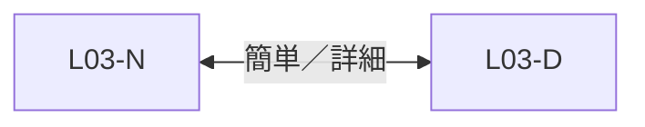
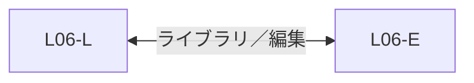
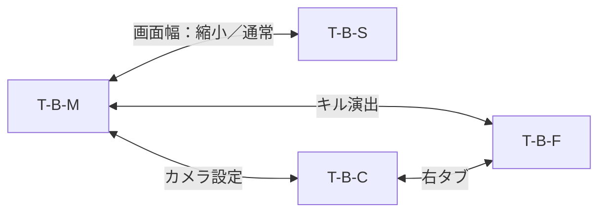
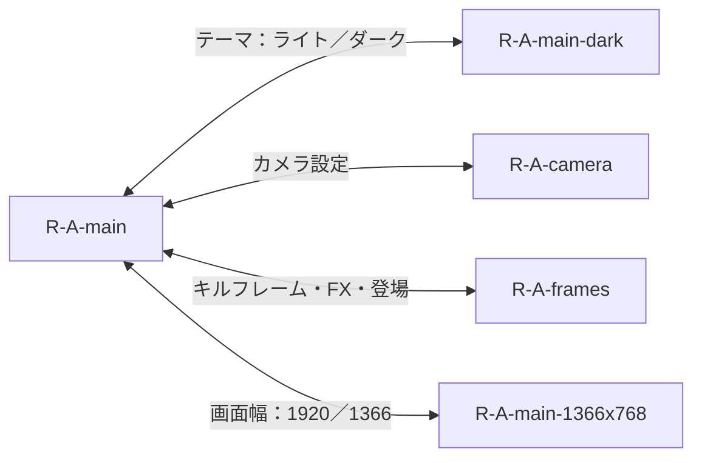
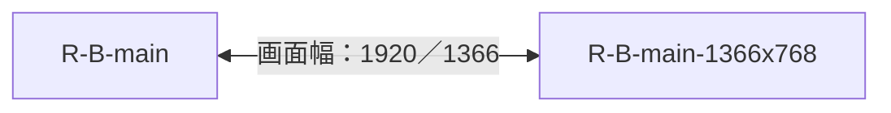
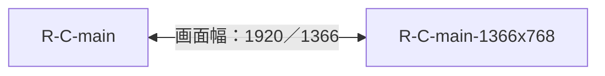
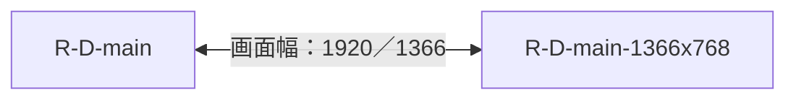
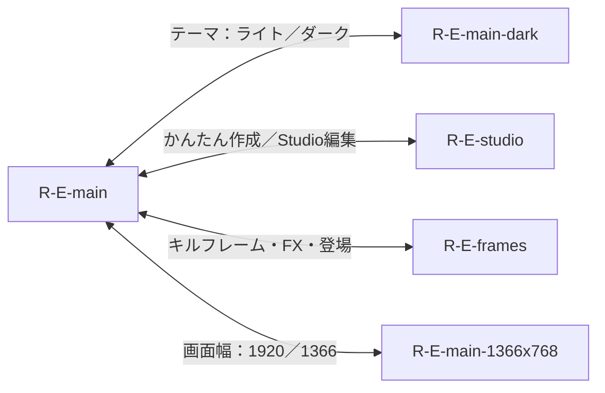
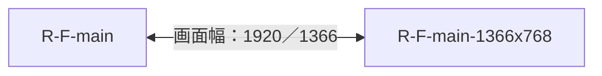

# 各候補の画面遷移（全29ID）

全12候補はユーザーが明示的に切り替える。採用は未決定。候補内の遷移は同じプロジェクト、選択、カメラ、ミラーを維持する。参照画像IDと実装ルートはSCREENS_29.json。テーマと画面幅は別アプリではない。

## 旧案2 標準編集

全F01〜F25はこの候補内の基本設定／詳細／素材／出力経路から到達する。補助状態に原本がない場合は「派生」と記録し、別候補のメイン画面で置換しない。
## 旧案3 ハイブリッド

全F01〜F25はこの候補内の基本設定／詳細／素材／出力経路から到達する。補助状態に原本がない場合は「派生」と記録し、別候補のメイン画面で置換しない。
## 旧案5 ウィザード

全F01〜F25はこの候補内の基本設定／詳細／素材／出力経路から到達する。補助状態に原本がない場合は「派生」と記録し、別候補のメイン画面で置換しない。
## 旧案6 ライブラリ／編集

全F01〜F25はこの候補内の基本設定／詳細／素材／出力経路から到達する。補助状態に原本がない場合は「派生」と記録し、別候補のメイン画面で置換しない。
## 旧テストA 現行整理

全F01〜F25はこの候補内の基本設定／詳細／素材／出力経路から到達する。補助状態に原本がない場合は「派生」と記録し、別候補のメイン画面で置換しない。
## 旧テストB カメラ・FX

全F01〜F25はこの候補内の基本設定／詳細／素材／出力経路から到達する。補助状態に原本がない場合は「派生」と記録し、別候補のメイン画面で置換しない。
## 新A Studio

全F01〜F25はこの候補内の基本設定／詳細／素材／出力経路から到達する。補助状態に原本がない場合は「派生」と記録し、別候補のメイン画面で置換しない。
## 新B Creator

全F01〜F25はこの候補内の基本設定／詳細／素材／出力経路から到達する。補助状態に原本がない場合は「派生」と記録し、別候補のメイン画面で置換しない。
## 新C Director

全F01〜F25はこの候補内の基本設定／詳細／素材／出力経路から到達する。補助状態に原本がない場合は「派生」と記録し、別候補のメイン画面で置換しない。
## 新D Highlights

全F01〜F25はこの候補内の基本設定／詳細／素材／出力経路から到達する。補助状態に原本がない場合は「派生」と記録し、別候補のメイン画面で置換しない。
## 新E Flow

全F01〜F25はこの候補内の基本設定／詳細／素材／出力経路から到達する。補助状態に原本がない場合は「派生」と記録し、別候補のメイン画面で置換しない。
## 新F Killbeat

全F01〜F25はこの候補内の基本設定／詳細／素材／出力経路から到達する。補助状態に原本がない場合は「派生」と記録し、別候補のメイン画面で置換しない。
## 資料HTMLの遷移をそのまま実装しない
新HTMLのE_studio.htmlへのデモリンクは、元の候補を保持した詳細編集ルートへ読み替える。CONTROL_ACTIONS.jsonに部品別のtarget_routeと、対応原本の有無を示した。A内Studio編集の原画は今回の対象に独立して提供されていないため、A内の補助状態として扱い、Eへ統合しない。
旧案5の4ステップは準備→検出→見た目→書き出し。新Bはプリセット→調整→書き出し、新Dはシーン→キュー→書き出し、新Fはキル→3フェーズ→書き出しの操作順を保持する。簡単編集への切替で詳細値や現在の選択を初期化しない。
候補切替・テーマ・リサイズ中も既存ジョブは同じバックエンドで継続。UI候補の保存はユーザーの最後の明示選択に限り、過去の推薦から決めない。