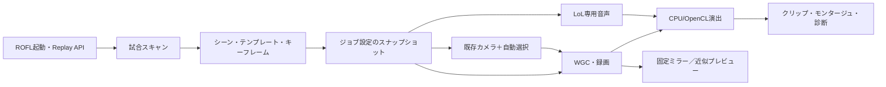

# 既存機能全面監査

> 調査日：2026-10-22 JST。コード基準：`fb03e0390805125fc063f4599af6c2541a653abf`。今回の作業は調査・設計のみ。実装、LoL実機操作、録画、既存テストの再実行は行っていません。提案値は未実測です。

## 監査範囲と証拠の強さ

最新UI比較版の読取スナップショット438ファイル、3,805,781 bytesを取得し、全件Git blob SHA-1一致を確認した。取得と原文精読は別であり、全行を精読したという意味ではない。coreの48 Pythonファイルを含み、重要経路は関数単位で原文を確認した。取得一覧はSOURCE_MANIFEST.json、実装棚卸しはFEATURE_STATUS.csv/JSONを参照。

最新基準は`codex/ui-29-implementation-20261021`のfb03e0390805125fc063f4599af6c2541a653abf（2026-10-21 16:39:40 UTC）。カメラ基準`feb895491ca4bc780da4aab91990f25177cd35ab`とcore/legacy範囲のblobを比較すると差異は`core/capture_process.py`と`legacy_app.py`。UI29開発ブランチへの書込み・アプリ起動・設定操作は行わない。mainは古い別構成のため基準にしない。

## 状態の定義

1=実装かつ今回の実機テスト合格、2=実装確認・今回の実機未検証、3=部分実装、4=今回不具合再現、5=未実装（監査した経路に該当処理なし）。今回1と4は付けていない。過去の合格、不具合報告、静的な疑義は別欄で管理する。重複、改善、統合、隠す候補、廃止候補は独立の提案タグであり、削除決定ではない。

## 構造

## 特に重要な判定

|項目|確認事実|不足・改善|
|---|---|---|
|キル・アシスト|ChampionKillとAssistersを収集、重複を除く|イベント欠落・中断スキャンの再利用を検査|
|エンゲージ|独立した検出根拠はスキャナにない|被ダメージ等の取得可能性調査、画像認識を後段提案|
|自動カメラ|旧10スタイルから承認リストに基づき選択|可視性に基づく自律探索は未実装|
|おまかせ演出|kill/assist/multikillでキーフレーム生成|新規Smart FX提案はこの既存機能を拡張|
|自動モンタージュ|簡易採点と強弱順並べ替えあり|画質・同一戦闘・音楽拍は採点しない|
|音声|音声必須時の開始・空・無音エラーは失敗|非ゼロだけではゲーム音の内容・AV同期は未保証|
|GPU|NVENCとOpenCL経路は別実装|列挙、実行成功、負荷、品質を別々に記録|
|素材|approved以外は確認用|原本の変更・承認昇格は行わない|

## 過去検証と今回検証

10月19日の集約JSONは1044件中1042pass・2環境ブロックを記載する一方、単一フル実行は1035件中1023pass・12failと記載する。再実行の集合を「最新コミット全件一括成功」に読み替えない。2件はWindows symlink権限WinError1314でassert前に停止したもの。10月13日Windows XMLの79件成功も歴史資料。今回のhead SHAに対するActions API返却は0件であり、テスト不合格の意味ではない。

今回実施：原文監査、438blob照合、Python構文AST確認、素材18点静的検査、公式資料照合。未実施：既存pytest、Windows/LoL録画、GPU FX実行、音声聴取、UI29起動。変更なしの研究作業で実機の状態を動かさない。

## 原文の入口

[core/scanner.py:41](https://github.com/Aimin2222/agdhnteweeffewwff/blob/fb03e0390805125fc063f4599af6c2541a653abf/LoL_AutoCine/core/scanner.py#L41)、[core/jobs.py:442](https://github.com/Aimin2222/agdhnteweeffewwff/blob/fb03e0390805125fc063f4599af6c2541a653abf/LoL_AutoCine/core/jobs.py#L442)、[ui/highlight_director.py:33](https://github.com/Aimin2222/agdhnteweeffewwff/blob/fb03e0390805125fc063f4599af6c2541a653abf/LoL_AutoCine/ui/highlight_director.py#L33)、[ui/smart_montage.py:29](https://github.com/Aimin2222/agdhnteweeffewwff/blob/fb03e0390805125fc063f4599af6c2541a653abf/LoL_AutoCine/ui/smart_montage.py#L29)、[core/auto_qa.py:19](https://github.com/Aimin2222/agdhnteweeffewwff/blob/fb03e0390805125fc063f4599af6c2541a653abf/LoL_AutoCine/core/auto_qa.py#L19)。各機能への個別リンクはCSV/JSONに収録。

## 保存機能の境界

scene_projectはtemp書込み・fsync・os.replaceによるatomic保存とundo/redoを持つ。一方、録画工程全体の永続checkpointや失敗clipだけの再開とは別機能。既存のatomic project saveを新規未実装として重複提案しない。scene_keyはeventIDも含むため、eventIDが変わる再scanでの照合を追加検証する。

## 依頼の分類6〜9との対応

6=機能重複、7=改善、8=統合、9=将来廃止は状態1〜5と直交するタグ。focus/vr/sphere blurは類似経路のため6/7/8候補だが、既存IDと見た目を削除しない。カメラの将来廃止は依存と実機比較の証拠が不足するため9を提案しない。未実装と判定した項目はエンゲージ独立検出と画像品質によるベストショット。既存のmetadataベース選択を未実装と呼んでいるのではない。
