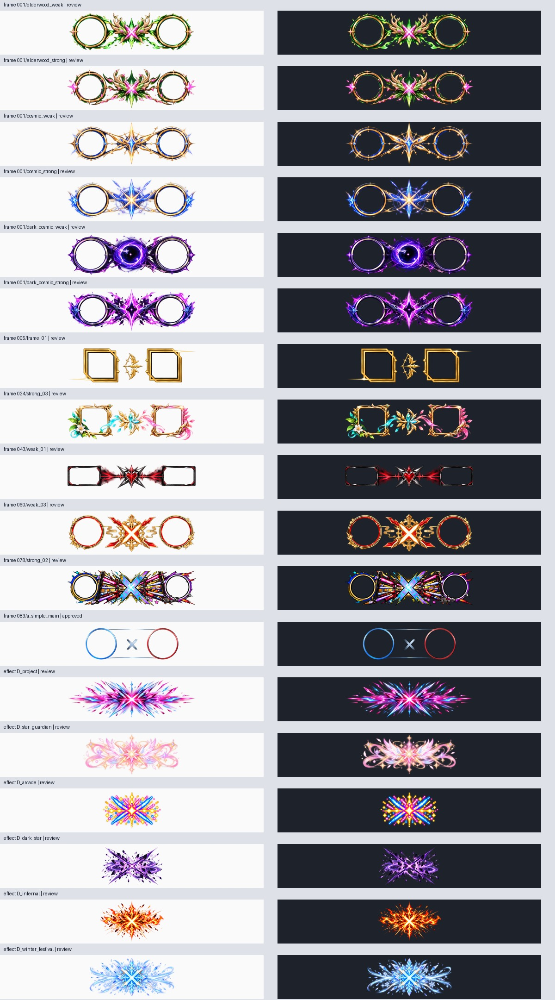

# キルフレーム・FX素材の品質監査

> 調査日：2026-10-22 JST。コード基準：`fb03e0390805125fc063f4599af6c2541a653abf`。今回の作業は調査・設計のみ。実装、LoL実機操作、録画、既存テストの再実行は行っていません。提案値は未実測です。

## 台帳と保護

[assets/work_kill_assets/catalog.json:1](https://github.com/Aimin2222/agdhnteweeffewwff/blob/fb03e0390805125fc063f4599af6c2541a653abf/LoL_AutoCine/assets/work_kill_assets/catalog.json#L1)を基準に、フレーム652=approved1＋review651、エフェクト35=review35。legacy_layers311を合わせたPNG998件がtreeに存在する。catalog内部のsource_commitは素材来歴であり、今回のコード基準SHAとは別。既存37バッジと89原本は編集・再生成・番号変更していない。

唯一のapprovedは`083/a_simple_main`、2520×1050 RGBA、SHA256 `b1b360c15d860e1fdd12ff01af67f5c1b9693538fa6d2b5babb9c0aa3602440f`。quality_scopeは静止画。動画合成と全6motionの承認を意味しない。

## 今回の実測

frame12/652、FX6/35を固定インデックスで抽出。18件すべてデコード成功、SHA256・台帳寸法一致。正規化したRGBAのalpha0/1–254/255割合をASSET_SAMPLE_QA.jsonへ保存した。29,567,101 bytesを読み取った。抜取りであり、未検査640frames/29FXの品質を推定しない。全998件の新規画素審査は未実施。

静止縮小表示で、円形/角形の肖像枠の違い、strongの装飾密度、淡いstar_guardianやwinter_festivalの背景依存を確認した。小さな欠け、1pixelの縁、原寸alphaゴミは縮小sheetだけでは合否判定できない。各PNGの承認は一切変更していない。

## 合成コードの条件

[core/work_kill_assets.py:43](https://github.com/Aimin2222/agdhnteweeffewwff/blob/fb03e0390805125fc063f4599af6c2541a653abf/LoL_AutoCine/core/work_kill_assets.py#L43)はreview表示をopt-inにし、[core/work_kill_assets.py:1](https://github.com/Aimin2222/agdhnteweeffewwff/blob/fb03e0390805125fc063f4599af6c2541a653abf/LoL_AutoCine/core/work_kill_assets.py#L1)等でpath/台帳/ハッシュを検証する。same themeのFX照合は利便性であり正式合格の継承ではない。reviewのportrait boxがない場合の仮配置を、正確な整合として保存しない。2520×1050 RGBAは約10.6MB、cache8だけで約85MB（10進数）の画素メモリに加えcopy等があり、652枚の原寸一括ロードは避ける。

## 6motion・アイコン審査

即表示・左/右/上/下スライド・ポップをそれぞれ、登場前/10%/50%/90%/静止/退場で確認。killer/victim逆転なし、肖像の円/角形切抜き、名前・体力UI遮蔽、連続キル上書き、2倍DPIでのジャギーを検査する。過去のsynthetic180frames/60fpsは形式成功の証拠でありLoL実合成の全品質保証ではない。

## 合格記録の設計

素材ID＋SHA256＋静止/動作/LoL合成のscope＋画面比＋motion＋killer/victim icon＋審査日時を分離。採点案：alpha/枠整合/切れ/視認/主役遮蔽/動作同期を各0–5。ただし重大欠陥1つは総合点で相殺しない。approved変更はユーザーの採用判断を待つ。実装変更案はサムネイル遅延ロード、承認フィルタ、背景切替、比較zoom。CPU合成・GPU表示の両経路で同じportrait配置を使う。

## バッジ数の内訳

原文ASTの定数を数えるとASSET_STYLES=37、STYLES=42（off＋手続き描画4＋素材37）、MOTION_STYLES=6。37素材の保護と、42個のUI識別子を維持することを区別する。今回は37種の新規全画素審査を行っていない。
